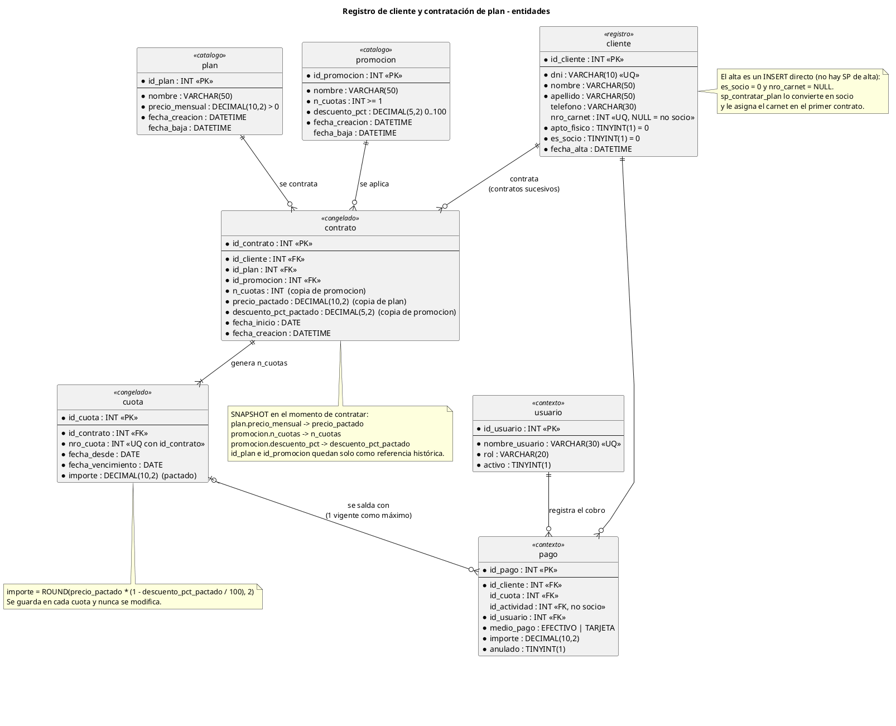
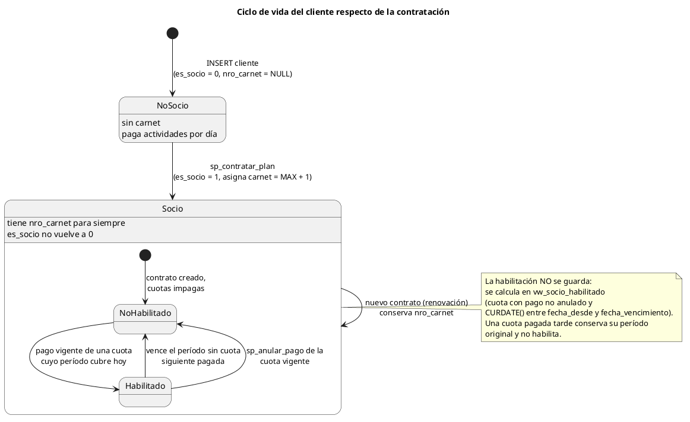
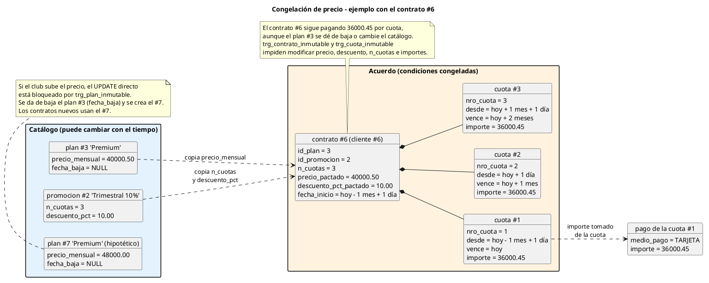

# Club Deportivo

Sistema de gestión para un club deportivo, desarrollado como Proyecto Integrador de la materia **Desarrollo de Sistemas Orientado a Objetos** (Tecnicatura Superior en Desarrollo de Software a Distancia, IFTS N° 29, 2° Cuatrimestre 2026).

## Resumen del proyecto

El sistema permite administrar de manera eficiente el servicio que presta el club, controlando:

1. Registro de socios y no socios.
2. Entrega de carnet y cobro de la cuota mensual o diaria.
3. Listado diario de los socios a los que les vence la cuota en la fecha.

**Lógica de negocio**

- La cuota se abona por adelantado, en efectivo o con tarjeta de crédito.
- Con tarjeta existen promociones en 3 y 6 cuotas.
- Los socios abonan una cuota mensual; los no socios solo abonan la actividad que realizan en el momento, según cartilla.
- Vencido el período de pago, el socio queda automáticamente inhabilitado para realizar actividades.
- Para retomar actividades debe pagar la cuota.
- El plazo de pago comienza a correr a partir del día siguiente al vencimiento de la cuota.

## Contratación de planes y pago de cuotas y actividades

La lógica vive en la base de datos (`database.sql`, compatible con MariaDB 10.2+ y MySQL 8) mediante tablas, triggers, una vista y Stored Procedures.

### Modelo de datos

El alta de un cliente es un `INSERT` directo (`es_socio = 0`, `nro_carnet = NULL`). Al contratar un plan se genera un **contrato**, que guarda una copia congelada del precio, el descuento y la cantidad de cuotas, y sus **cuotas**, cada una con su período mensual, su vencimiento y su importe pactado. Un **pago** salda una cuota (socio) o una actividad del día (no socio).

### Ciclo de vida del cliente

Un cliente comienza como **no socio** y paga por día. Al ejecutar `sp_contratar_plan` pasa a ser **socio**: se le asigna el carnet, que conserva para siempre, y se generan sus cuotas. La habilitación **no se guarda**: se calcula en la vista `vw_socio_habilitado`, que incluye al socio solo si tiene una cuota pagada (no anulada) cuyo período cubre la fecha actual.

### Procedimientos principales

| Procedimiento | Función |
|---|---|
| `sp_contratar_plan` | Congela las condiciones, genera las cuotas y asigna el carnet en el primer contrato, dentro de una transacción. Rechaza contratos que se superpongan con cuotas existentes. |
| `sp_registrar_pago_cuota` | Cobra una cuota con el importe pactado. Los contratos de más de una cuota (promociones de 3 o 6) se abonan solo con tarjeta. Una cuota vencida se registra pero **no habilita** al socio: conserva su período original. |
| `sp_registrar_pago_actividad` | Cobra la actividad del día a un cliente sin cuota vigente, según la cartilla. Un socio habilitado no paga por día. La falta de apto físico advierte, pero no bloquea el cobro. |
| `sp_anular_pago` | Anula un pago conservando el motivo (obligatorio) para auditoría. |
| `sp_listado_vencimientos_diario` | Lista los socios cuya cobertura vence en la fecha indicada (por omisión, hoy) y que todavía no pagaron una cuota posterior. |

### Congelación de precios

Los planes y las promociones son un catálogo inmutable: si el club cambia un precio, se da de baja el plan y se crea uno nuevo. Los contratos ya firmados siguen cobrando lo pactado, porque triggers (`trg_plan_inmutable`, `trg_promocion_inmutable`, `trg_contrato_inmutable`, `trg_cuota_inmutable`) impiden modificar precios, descuentos, cantidad de cuotas, importes y períodos.

